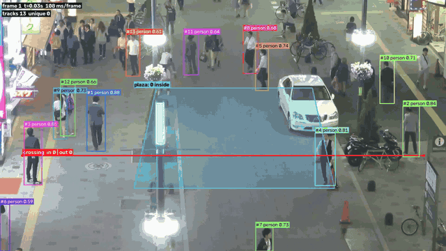
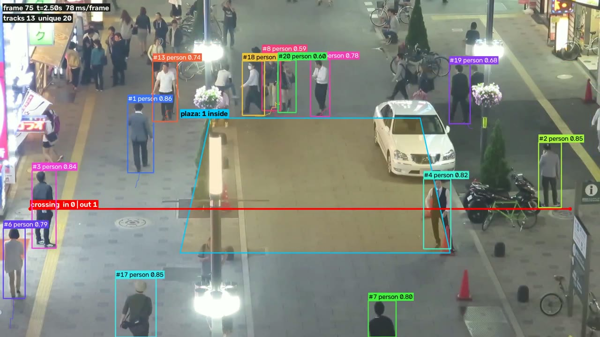
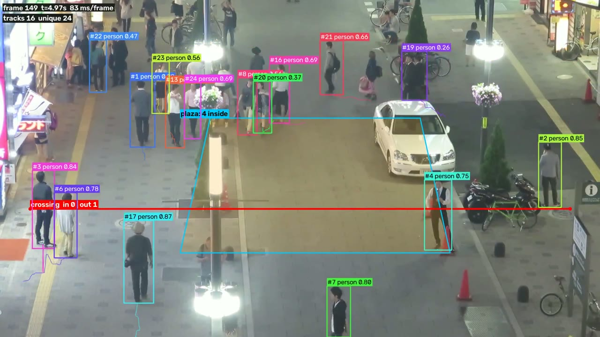
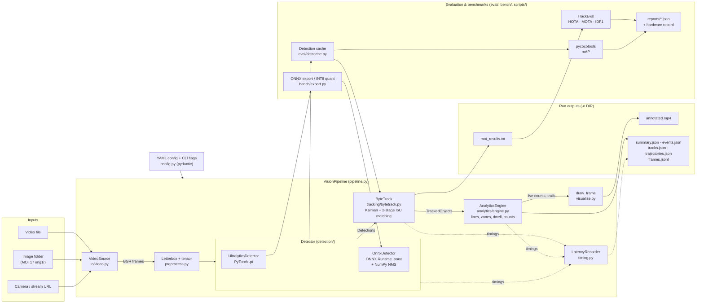

# VisionTrack

Object detection, multi-object tracking and track-based analytics for video, plus the
evaluation harness used to measure it and an ONNX Runtime backend for CPU/edge inference.

VisionTrack reads a video file, an image folder (MOTChallenge layout), a camera or a stream,
detects people and road vehicles with YOLO11, tracks them with a ByteTrack implementation
written from the paper, and turns the tracks into counts: unique objects per class,
directional line crossings, zone entries/exits and dwell time. Each run writes an annotated
video and JSON/MOT files. The same detector and tracker are scored against MOT17 ground truth
with TrackEval (HOTA, MOTA, IDF1) and pycocotools (mAP).

<p align="center">
  
  <br>
  <sub>Output of <code>visiontrack run</code> on the first 150 frames of MOT17-04, CPU only, YOLO11n @ 960 px: track IDs and trails, the red counting line and the blue "plaza" zone.</sub>
</p>

Milestones M1 to M5 from [docs/PLAN.md](docs/PLAN.md) are done; the rest are listed under
[Roadmap](#roadmap).

Some details worth knowing:

* Two detector backends, chosen by the weights extension: PyTorch through `ultralytics` (`.pt`),
  and ONNX Runtime (`.onnx`) with its own NumPy letterbox, decoding and NMS, so the ONNX path
  doesn't load torch at inference time.
* ByteTrack is implemented from scratch. An adapter around ultralytics' `BYTETracker`
  (`--tracker ultralytics_bytetrack`) is there to cross-check it.
* Analytics count tracks, not detections: a minimum-hits rule filters flicker, line crossings use
  hysteresis and count once per track, zones debounce enter/exit. Known limitations (ID switches,
  pixel units) are written into every `summary.json`.
* Per-stage latency (decode, pre-process, inference, post-process, tracker, analytics, render)
  as p50/p95/p99, plus warm-up time and peak RSS.
* MOT17 train is split per sequence into half-1 (tuning) and half-2 (held out). Deterministic
  perturbations (motion blur, low light, downscale, JPEG) are available for robustness runs.
* ONNX export to FP32 (static and dynamic shapes), FP16 and INT8 static quantisation (ORT QDQ,
  calibrated on the tuning split only), with raw-output parity tests against PyTorch.

## Demo output

Produced by this command on frames 1 to 150 of MOT17-04 (1920x1080, 30 FPS), CPU only, on the
laptop described under [Results](#results):

```bash
visiontrack run data/MOT17/train/MOT17-04-FRCNN/img1 \
    --config configs/mot17-04-demo.yaml \
    --weights yolo11n.pt --imgsz 960 --device cpu --max-frames 150 \
    -o outputs/readme_demo
```

| Frame 75: IDs, trails, line and zone counters | Frame 149: 16 active tracks, 24 unique so far, 4 people inside the zone |
|---|---|
|  |  |

The top-left HUD shows frame index, timestamp, per-frame processing time, active tracks and the
running unique count. The line reports `in`/`out` crossings and the zone label shows current
occupancy. YOLO11n at 960 px misses a lot of the small pedestrians at the top of the frame; the
YOLO11s @ 1280 setting in `configs/mot17-04-demo.yaml` picks up more of them but is slower on CPU.

CLI output (stdout; progress goes to stderr):

```json
{
  "output_dir": "outputs/readme_demo",
  "frames": 150,
  "throughput_fps": 7.88,
  "end_to_end_ms_p50": 113.006,
  "detector_ms_p50": 88.211,
  "unique_objects": {
    "total": 24,
    "by_class": { "person": 24 }
  },
  "lines": {
    "crossing": {
      "in":  { "total": 0, "by_class": {} },
      "out": { "total": 1, "by_class": { "person": 1 } }
    }
  }
}
```

From `summary.json`:

```json
"zones": [{
  "name": "plaza",
  "unique_visitors": { "total": 6, "by_class": { "person": 6 } },
  "entries": 7, "exits": 7,
  "dwell_s": { "complete_visits": 1, "mean_complete": 0.267, "max_any": 4.967 }
}],
"per_class": { "person": { "unique_tracks": 24, "mean_track_duration_s": 3.104, "mean_speed_px_per_s": 77.54 } }
```

| Stage (CPU, YOLO11n @ 960) | p50 ms | p95 ms |
|---|---:|---:|
| decode | 6.5 | 8.9 |
| detector (total) | 88.2 | 128.4 |
| &nbsp;&nbsp;pre-process / inference / post-process | 2.4 / 83.8 / 1.1 | 3.6 / 124.1 / 2.0 |
| ByteTrack | 1.7 | 2.8 |
| analytics | 0.2 | 0.3 |
| render + encode | 15.6 | 19.9 |
| end-to-end | 113.0 | 157.6 |

Wall time 19.0 s, warm-up 458 ms, peak RSS 796 MB, from a single run.

An event from `events.json`:

```json
{ "type": "line_crossing", "frame_index": 9, "timestamp_s": 0.3, "track_id": 2,
  "class_name": "person", "line": "crossing", "direction": "out", "counted": true }
```

With the ONNX backend on the same clip (`--weights models/onnx/yolo11n_640_fp32.onnx --imgsz 640
--max-frames 60 --no-video`) the detector p50 was 57.8 ms. `visiontrack detect data/samples/bus.jpg
--weights models/onnx/yolo11n_640_fp32.onnx --device cpu` returns 5 detections (bus 0.94, persons
0.90, 0.85, 0.83, 0.40) as JSON with a timing breakdown.

## How it works

1. `io/video.py`: `VideoSource` reads a video file, a MOTChallenge `img1/` folder, a webcam index
   or a stream URL, with `stride`, `start_frame` and `max_frames`, and estimates FPS when the
   container doesn't report it. `VideoWriter` writes `mp4v` and transcodes to H.264 if `ffmpeg`
   is on the PATH.
2. `preprocess.py`: aspect-preserving letterbox (stride 32, pad 114), BGR to RGB, NCHW float
   tensor. It mirrors ultralytics' `LetterBox`, and a test checks both backends get identical
   tensors.
3. `detection/`: `UltralyticsDetector` (PyTorch, CPU or CUDA, optional FP16 and batching) and
   `OnnxDetector` (ONNX Runtime on CPU or the CUDA provider, then NumPy decoding, class
   filtering, NMS and rescaling). Both return plain NumPy `Detections` (`xyxy`, `scores`,
   `class_ids`) and per-call timings.
4. `tracking/`: Kalman predict, first association on high-score boxes, second association of the
   leftover tracks with low-score boxes, recovery of unconfirmed tracks, births, and removal after
   `track_buffer` frames lost. The config validator lowers the tracker's low threshold if the
   detector threshold would otherwise starve the second stage.
5. `analytics/`: each track is reduced to an anchor point (bottom-centre by default), tested
   against lines (signed distance with hysteresis) and zone polygons (point-in-polygon with
   enter/exit debouncing). `AnalyticsEngine` emits events and keeps per-track records,
   trajectories and live counters.
6. `visualize.py`, `pipeline.py`: frames are annotated and encoded; at the end of a run
   `VisionPipeline` writes the JSON summaries, event log, per-frame records and MOT-format
   results, and reduces the latency samples to p50/p95/p99.

`VisionPipeline` only talks to the `Detector`, `Tracker` and `AnalyticsEngine` interfaces, so a
backend or tracker can be swapped without touching the rest.

## Architecture



Solid arrows are the per-frame flow of `visiontrack run`; dotted arrows are latency samples. The
evaluation block reuses the same detector and tracker classes offline. Detections are cached once
per MOT17 sequence so every tracker experiment sees identical inputs, then scored with TrackEval
and pycocotools, and each result is saved as JSON together with the hardware it ran on.
`bench/export.py` produces the models `OnnxDetector` loads.

## Project structure

```text
VisionTrack/
├── visiontrack/
│   ├── cli.py              # visiontrack run | detect | serve
│   ├── pipeline.py         # decode -> detect -> track -> analyse -> render/serialise
│   ├── config.py           # pydantic configs for every stage + YAML loader
│   ├── types.py            # Detections, TrackedObject, FrameResult, COCO names
│   ├── preprocess.py       # letterbox, tensor conversion, NumPy NMS, box rescaling
│   ├── visualize.py        # boxes, IDs, trails, lines, zones, HUD
│   ├── timing.py           # latency recorder (p50/p95/p99), peak RSS
│   ├── io/video.py         # VideoSource (file / image folder / camera / stream), VideoWriter
│   ├── detection/          # Detector interface, ultralytics and ONNX Runtime backends
│   ├── tracking/           # ByteTrack, Kalman filter, matching, ultralytics adapter
│   ├── analytics/          # AnalyticsEngine (lines, zones, dwell, counts), geometry
│   ├── eval/               # MOT17 splits, detection cache, TrackEval/COCO metrics, perturbations, hardware info
│   └── bench/              # ONNX export + INT8 quantisation
├── configs/mot17-04-demo.yaml   # counting line + zone for MOT17-04
├── scripts/                # data download, MOT17 experiments, COCO eval, ONNX export and parity check
├── tests/
├── docker/Dockerfile       # CPU image for the CLI
├── docker-compose.yml
└── docs/                   # PLAN.md, deployment.md, assets/
```

`data/`, `models/`, `runs/` and `outputs/` are created locally and git-ignored. `reports/` holds
the experiment records.

Stack: Python 3.10 to 3.12 (developed on 3.12), Ultralytics YOLO11, ONNX Runtime, NumPy, SciPy
(Hungarian assignment), OpenCV, pydantic v2, TrackEval, pycocotools, uv, pytest, ruff, Docker.

## Installation

Needs Python 3.10 to 3.12 and [uv](https://docs.astral.sh/uv/) (plain `pip` works too). `ffmpeg`
is optional and gives H.264 output. Everything runs on CPU; a GPU is optional.

```bash
git clone https://github.com/Sanskriti10247/VisionTrack.git
cd VisionTrack
uv venv --python 3.12
source .venv/bin/activate
uv pip install -e ".[onnx,eval,dev]"
```

| Extra | Adds | Needed for |
|---|---|---|
| *(core)* | numpy, opencv-python, scipy, pydantic, pyyaml, psutil, ultralytics | `run` / `detect` with `.pt` weights |
| `onnx` | onnx, onnxruntime, onnxslim | `.onnx` weights, export, quantisation |
| `eval` | pycocotools, TrackEval (pinned commit), matplotlib, lap, tabulate | MOT17 / COCO evaluation |
| `api` | fastapi, uvicorn, python-multipart | `visiontrack serve` |
| `dev` | pytest, httpx, ruff | tests and linting |

On a CPU-only machine, install the CPU build of PyTorch first to skip the CUDA wheels:
`uv pip install torch torchvision --index-url https://download.pytorch.org/whl/cpu`.

## Models and data

For the PyTorch path nothing has to be fetched by hand: `--weights yolo11n.pt` (or `yolo11s.pt`)
is looked up in `./models/` and ultralytics downloads it there if missing. ONNX models are
exported into `models/onnx/` (e.g. `yolo11n_640_fp32.onnx`, `yolo11s_640_int8.onnx`):

```bash
python scripts/export_models.py            # FP32 (several sizes, static + dynamic), FP16 (GPU), INT8
python scripts/export_models.py --no-gpu   # skip FP16 on CPU-only machines
```

INT8 calibration uses 200 frames from MOT17 half-1, so download MOT17 first.

Data is only needed for evaluation and the MOT17 demo; `visiontrack run` works on any video.

```bash
scripts/download_data.sh          # MOT17 (~5.5 GB, CC BY-NC-SA 3.0) + COCO val2017 (~1 GB)
scripts/download_data.sh mot17    # MOT17 only; also builds data/mot17/{half1,half2,full}
```

| Path | Contents | Source |
|---|---|---|
| `data/MOT17/train/*-FRCNN/` | 7 sequences, 5,316 frames with tracking GT | `download_data.sh mot17` |
| `data/mot17/{half1,half2,full}` | tuning / held-out / full splits | `prepare_mot17.py` (called by the script) |
| `data/coco/` | val2017 images + annotations | `download_data.sh coco` |
| `data/samples/bus.jpg` | a single test image | `detect` examples |

## Usage

```text
$ visiontrack --help
usage: visiontrack [-h] {run,detect,serve} ...
    run      detect + track + analyse a video, image folder or camera
    detect   run the detector on images and print JSON
    serve    start the FastAPI service
```

`visiontrack run SOURCE [options]`, where `SOURCE` is a video file, image directory, camera index
or stream URL.

| Flag | Meaning |
|---|---|
| `-o, --output DIR` | output directory (default `outputs/run`) |
| `--config FILE` | YAML pipeline config (detector, tracker, analytics, video, output) |
| `--weights W` | `.pt` (PyTorch) or `.onnx` (ONNX Runtime) |
| `--imgsz N` | model input size, multiple of 32 |
| `--conf`, `--iou` | detector confidence and NMS IoU thresholds |
| `--device` | `auto`, `cpu` or `cuda:0` |
| `--half`, `--batch N` | FP16 (GPU) and detector batch size |
| `--stride N`, `--max-frames N` | process every Nth frame, or stop after N frames |
| `--tracker` | `bytetrack` (default) or `ultralytics_bytetrack` |
| `--no-video` | don't write `annotated.mp4` |

Each run writes `annotated.mp4`, `summary.json`, `events.json`, `tracks.json`,
`trajectories.json`, `frames.jsonl` and `mot_results.txt` (MOTChallenge format) to the output
directory.

```bash
# any video, defaults (YOLO11n, people + road vehicles)
visiontrack run path/to/video.mp4 -o outputs/my_video

# MOT17-04 with line and zone, ONNX Runtime on CPU, JSON only
visiontrack run data/MOT17/train/MOT17-04-FRCNN/img1 --config configs/mot17-04-demo.yaml \
    --weights models/onnx/yolo11n_640_fp32.onnx --imgsz 640 --device cpu --no-video -o outputs/onnx

# detector only, JSON to stdout
visiontrack detect data/samples/bus.jpg --weights yolo11n.pt --device cpu
```

Lines and zones are set in YAML. With `normalized_coordinates: true` coordinates are fractions of
the frame size. From `configs/mot17-04-demo.yaml`:

```yaml
detector:
  weights: yolo11s.pt
  imgsz: 1280
  conf_threshold: 0.1
  classes: [0]            # people only: MOT17 annotates pedestrians
tracker:
  type: bytetrack
analytics:
  normalized_coordinates: true
  lines:
    - name: crossing
      p1: [0.05, 0.62]
      p2: [0.95, 0.62]
  zones:
    - name: plaza
      polygon: [[0.35, 0.35], [0.70, 0.35], [0.75, 0.75], [0.30, 0.75]]
```

All fields, defaults and validation live in `visiontrack/config.py` (ByteTrack thresholds,
`track_buffer`, line `hysteresis_px`, zone `min_frames_inside`/`min_frames_outside`, anchor
point, `min_track_hits`, trail length, ...). Any field can also be overridden from Python:

```python
from visiontrack.config import load_config
from visiontrack.pipeline import VisionPipeline

cfg = load_config("configs/mot17-04-demo.yaml", {"detector": {"weights": "yolo11n.pt", "device": "cpu"}})
result = VisionPipeline(cfg).process_video("path/to/video.mp4", "outputs/py_run")
print(result.summary["analytics"]["unique_objects"])
```

Evaluation scripts:

```bash
python scripts/run_mot17_experiments.py --suite detectors      # model size x resolution on MOT17
python scripts/run_mot17_experiments.py --suite all --detector yolo11s.pt:1280
python scripts/eval_coco.py --weights yolo11s.pt --imgsz 640    # COCO val2017 mAP
python scripts/verify_export.py                                # PyTorch vs ONNX parity
```

## Results

Same rules as [docs/PLAN.md](docs/PLAN.md): a number only goes here if a script in this repo
produced it, tracking metrics only come from MOT17 ground truth, and every record stores the
hardware it ran on.

All numbers in this README, including the demo above, come from one laptop (Intel i5-13420H,
12 threads; RTX 4050 Laptop 6 GB; 16 GB RAM, often only ~3 GB free) that was running other
workloads at the time (1-minute load average 6.5 to 11.5). Timings are indicative, not a
controlled benchmark.

### MOT17 half-1: detector size x input resolution

Source: `reports/experiments/detectors/*.json` (`scripts/run_mot17_experiments.py --suite
detectors`), default ByteTrack, detector confidence 0.1. Split: MOT17 train half-1 (7 sequences,
2,657 frames). This is the tuning split, not the held-out half-2.

| Detector | Input | HOTA | MOTA | IDF1 | IDSW | Det. mAP@0.5 | Det. mAP@0.5:0.95 |
|---|---:|---:|---:|---:|---:|---:|---:|
| YOLO11n | 640 | 34.93 | 26.34 | 37.56 | 85 | 0.657 | 0.342 |
| YOLO11s | 640 | 39.12 | 31.05 | 43.43 | 116 | 0.705 | 0.376 |
| YOLO11n | 1280 | **45.08** | **41.84** | **52.81** | 189 | **0.777** | **0.439** |

On MOT17, input resolution matters more than model size because many pedestrians are small.
Going from 640 to 1280 px adds about 10 HOTA points to YOLO11n, almost all from detection (DetA
23.2 to 38.2, AssA flat at ~53). More recovered objects also means more chances to switch IDs,
so IDSW goes up too. These are COCO-pretrained models without MOT17 fine-tuning, so absolute
numbers are well below fine-tuned results in the literature.

## Testing

```bash
pytest                    # whole suite
pytest -m "not slow"      # skip tests that need downloaded weights
```

62 tests, all passing including the slow ones:

| File | Tests | Covers |
|---|---:|---|
| `test_tracker.py` | 16 | Kalman filter, association stages, track lifecycle, ID persistence, class gating |
| `test_analytics.py` | 15 | line crossings, hysteresis, double-counting edge cases, zone debouncing, dwell |
| `test_preprocess.py` | 14 | letterbox vs ultralytics, NMS, PyTorch vs ONNX raw-output parity |
| `test_video.py` | 6 | image-folder / video sources, invalid inputs, writer round-trip |
| `test_metrics.py` | 6 | TrackEval and pycocotools wrappers on synthetic ground truth |
| `test_pipeline.py` | 4 | end-to-end pipeline with stub detectors |
| `test_detcache.py` | 1 | detection cache batching / max-det bookkeeping |

## Docker

A CPU image (PyTorch CPU wheels + ONNX Runtime, non-root) runs the CLI. Weights and data are
mounted, not baked in.

```bash
docker compose build
docker compose run --rm visiontrack run /app/data/MOT17/train/MOT17-04-FRCNN/img1 \
    --config configs/mot17-04-demo.yaml --weights models/onnx/yolo11n_640_fp32.onnx \
    --imgsz 640 --device cpu --max-frames 150 -o /app/outputs/docker_demo
```

Build options, volumes, environment variables, sizing and platform notes are in
[docs/deployment.md](docs/deployment.md).

## Roadmap

| # | Milestone | Status |
|---|---|---|
| M1 | Minimal pipeline: video, YOLO, ByteTrack, annotated video + stats | done |
| M2 | Trajectory analytics: lines, zones, dwell, unique counts | done |
| M3 | Evaluation framework: pycocotools + TrackEval, detection cache | done |
| M4 | Controlled experiments + robustness | detector suite partly run on half-1. YOLO11s @ 1280, half-2, tracker sweeps, robustness and COCO val2017 mAP still to run |
| M5 | ONNX export + edge inference | backend, export and quantisation done (parity covered by tests). Controlled latency benchmarks still to run |
| M6 | FastAPI service | not done. `visiontrack serve` is wired in the CLI but `visiontrack/api/app.py` doesn't exist yet, so it fails on import |
| M7 | Dashboard | not started |
| M8 | Packaging + report | CPU Dockerfile + compose done. GPU image, API docs and technical report to do |

## Acknowledgements

* ByteTrack: Zhang et al., *ByteTrack: Multi-Object Tracking by Associating Every Detection Box*, ECCV 2022.
* [Ultralytics YOLO11](https://github.com/ultralytics/ultralytics), [ONNX Runtime](https://onnxruntime.ai/), [TrackEval](https://github.com/JonathonLuiten/TrackEval), [pycocotools](https://github.com/cocodataset/cocoapi).
* [MOT17](https://motchallenge.net/data/MOT17/) (CC BY-NC-SA 3.0) and [COCO](https://cocodataset.org/) datasets.

## License

MIT (see `pyproject.toml`). Dataset and model-weight licenses belong to their owners.
